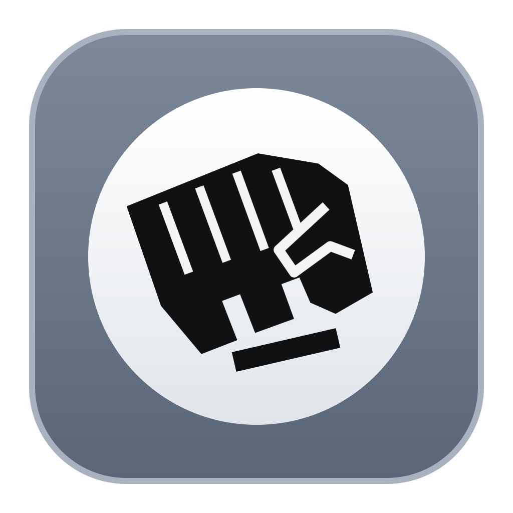

<p align="center">
  
</p>

<h1 align="center">Zushi</h1>

<p align="center">
  <a href="https://github.com/Mouadzz/zushi/releases/latest"></a>
</p>

<p align="center">
  
  
  
  
  
</p>

<p align="center">
  A lightweight desktop app to browse and apply League of Legends skins.
</p>

---

<p align="center">
  
</p>

## Features

- Browse all champions and their skins with splash art previews
- Download individual skins or batch download all skins for a champion
- Select and apply multiple skins at once - one per champion
- Import custom mods (.fantome/.zip)
- Real-time patcher status (importing, waiting for game, skins active, etc.)
- Game auto-detection - finds your League installation automatically
- Storage management - clear downloaded skins and patcher data
- macOS native - Apple Silicon and Intel

## Installation

1. Download the latest `.dmg` for your Mac from the [Releases page](https://github.com/Mouadzz/zushi/releases/latest):
   - **Apple Silicon** (M1/M2/M3/M4/M5...) - `Zushi_x.x.x_aarch64.dmg`
   - **Intel** - `Zushi_x.x.x_x64.dmg`
2. Open the `.dmg` and drag Zushi to your Applications folder
3. On first launch, macOS may show **"Zushi is damaged and can't be opened"** - this is normal for ad-hoc signed apps. To fix this, run in Terminal:
   ```
   xattr -cr /Applications/Zushi.app
   ```
   Then open the app again normally.

## Usage

1. **Start League client** - Open the Riot/League client first and leave it running.
2. **Run Zushi** - Open Zushi once the client is up.
3. **Download & apply skins** - Pick a champion, download skins if needed, then go to **My Skins**, select one skin per champion, and click **Apply**.
4. **Start your game** - With the patcher showing **Waiting for game**, queue up and play.

> **Important:** Apply the skin before champion select ends (use the default skin in client) so it is locked in when the game starts. If it does not apply, close the game, reopen League, run Zushi again, apply, and reconnect.

## Disclaimer

Zushi is not endorsed by Riot Games and does not reflect the views or opinions of Riot Games or anyone officially involved in producing or managing Riot Games properties. Riot Games and all associated properties are trademarks or registered trademarks of Riot Games, Inc.

Skins are visible only to you and do not affect gameplay or provide any competitive advantage. Use at your own risk.


## License

This project is licensed under the MIT License.

## Credits

- [cslol-manager](https://github.com/LeagueToolkit/cslol-manager) - modding tools
- [LeagueSkins](https://github.com/Alban1911/LeagueSkins) - a comprehensive collection of League of Legends skin assets, organized by champion and skin IDs

## 本地编译与安装

在 macOS 上双击 `scripts/build-install.command`，或在终端运行：

```bash
./scripts/build-install.command
```

脚本会安装锁定的 npm 依赖、运行功能测试、编译 mod-tools 和 Zushi，
将程序安装到 `/Applications/Zushi.app` 后打开。旧版程序保存在
`.local-build/backups/`，已有皮肤数据保留。正在运行的 Zushi 会先收到退出请求。

需要 Xcode Command Line Tools、Node.js 22.6+、Rust stable 和 CMake 3.20+。
此副本已在 `.local-build/tools/`（或工作区旁边的 `work/`）中准备本地工具，脚本会自动使用它们。
仅编译可运行 `BUILD_ONLY=1 ./scripts/build-install.command`；
只安装已有编译结果可运行 `./scripts/build-install.command --install-only`。

下载现使用最多 10 个请求并行的去重队列，可在下载期间继续浏览和添加其他皮肤。
连续点击同一英雄的 Download All 时，正在下载或排队的皮肤不会重复加入；已下载皮肤会跳过。
连接超时为 15 秒、单个请求（含响应读取）总超时为 120 秒；
失败会显示错误并继续下一项，可重新点击失败的皮肤重试。

游戏路径会保存到应用数据目录的 `game-path.json`。启动时优先恢复并验证已保存路径，
其次检查 `/Applications` 以及 `/Volumes` 下的英雄联盟安装位置；找到有效路径会直接进入主界面。
游戏移动或外置盘未连接且没有其他有效安装时，才会重新显示路径选择。

## 全部皮肤离线库

运行 `scripts/download-all-skins.command` 可一次下载整个皮肤仓库，并校验导入到
`/Volumes/out_device/ZushiSkins`。重复导入会跳过相同内容。完整压缩包保存在
`.local-build/all-skins.tar.gz`，可加 `--import-existing` 无需联网重新导入。
Zushi 会自动识别并记住该目录，My Skins 显示皮肤及炫彩的总数量。
本地名称索引和文件清单也一起导入，浏览皮肤无需再请求 GitHub 原始文件地址。

## 英雄筛选与页面性能

My Skins 先显示英雄入口和每位英雄的已下载数量；点开英雄后才生成其皮肤卡片，
每页最多 24 组皮肤。缩略图延迟加载，英雄索引复用，避免打开页面时同时处理和显示全部皮肤。
返回列表会保留搜索及位置筛选，已选皮肤继续保留。

Champions 与 My Skins 均可按中文姓名、称号、常用别名及英文名搜索，
并与上单、打野、中单、下路、辅助的位置筛选组合使用。
中文及位置索引随程序内置；位置来自客户端召唤师峡谷的推荐资料，多位置英雄会在多个分类中出现。

## 一键获取全部英雄皮肤

Champions 与 My Skins 顶部的“一键获取全部皮肤”会一次下载最新仓库压缩包，
校验并导入全部英雄的皮肤及炫彩。页面显示已下载大小和导入数量，已有相同内容会跳过。
获取过程中可以继续浏览，可点击“停止获取”；已导入文件保留，再次获取会跳过已有内容。
完成后 My Skins 自动刷新，其他用户无需准备外置盘，默认使用应用自己的皮肤目录。
首次获取需要联网，压缩包缓存在应用缓存目录。
本地编译如需跳过测试，可运行 `SKIP_TESTS=1 ./scripts/build-install.command`。

## 客户端识别与战绩查询

打开并登录英雄联盟客户端后，Zushi 会自动连接本机 LCU 接口，显示当前账号与客户端阶段。
“自动定位英雄”默认开启；选人时选定或交换英雄，会自动打开该英雄的已下载皮肤页，
没有下载时打开其下载页。可以关闭此开关，或手动点击“定位皮肤”。皮肤仍由用户选择并点击 Apply。

左侧“战绩查询”自动识别当前账号，默认逐批读取最近 100 场，每页 10 场。
支持上一页、下一页、直接跳页，以及追加 100 场或读取最多 500 场。
客户端返回不到更多记录或请求失败时，保留已经读取的对局，显示实际数量。
查询中可以停止读取；离开页面会停止继续发请求，已读取结果保存在本次程序会话缓存中。

输入玩家的 `名字#标签` 可查询当前服务器其他玩家；查询依次尝试 Riot ID、账号别名及显示名接口。
主页展示头像、等级、单双排/灵活排位段位及常用英雄统计；可按模式、胜负和英雄中文/英文名筛选已加载记录。
对局详情按队伍展示英雄、召唤师技能、主符文、七个装备栏、KDA、伤害条、金币、补刀/分和参团率，
并展示客户端实际提供的队伍击杀、金币及地图资源。竞技场按小队分组并显示名次。
点击玩家名字可查询其战绩，左上角返回键返回之前查询的玩家。装备和技能图标优先从本机客户端获取，
最多四个图片请求并行，去重并缓存，失败不影响战绩阅读。跨服务器、隐藏身份及客户端未提供的数据不作推断。
认证从当前安装目录的 lockfile 读取，只保留在 Rust 内存中，不传给页面或放进进程参数；
客户端查询仅连接 `127.0.0.1`，不需要用户申请 Riot API Key。
接口接入方式参考 [League Akari](https://github.com/LeagueAkari/LeagueAkari) 的 LCU HTTP 辅助模块，未复制源代码。

本次战绩改进参考 [lol-copilot](https://github.com/AIPythoner/lol-copilot) 的 LCU 接口与信息展示方式，独立实现，未复制源代码。按用户要求只编译，不运行测试。

## 一键随机并应用优质皮肤

Champions 和 My Skins 顶部新增“一键随机并应用”，直接为所有已下载英雄各选一款并启动应用。
候选仅包括元数据确认的史诗、传说、终极、神话、超凡、殿堂品质，不包含原皮或炫彩。
优先选择较高品质；没有时优先挑选常见特效主题史诗/神话。部分老版传说皮肤列入排除清单。
品质只是筛选依据，不等于玩家评分；用户可填写英文名称关键词排除不喜欢的皮肤/系列。
没有合格候选的英雄会明确跳过，不用低品质或未知皮肤补齐。再次随机尽量避开上次选择。
展开规则可以查看每位英雄的选择和候选数量。批量导入显示进度，Stop 可以取消后续导入。

## 云端战绩分页

部分客户端会忽略 LCU 的分页参数，每页都返回同样的最近 20 场。新版会明确显示这个原因。
战绩页面可启用 SGP 云端接口，默认读取 100 场、每页 10 场，上限 500；实际数量由服务器提供。
首次启用需明确授权：从本机读取登录授权，仅发送给当前区服配置的 Riot 战绩服务器；
启用 HTTPS 证书校验、禁止跳转，不把令牌写入磁盘、发送到页面或放进进程参数。
授权偏好按服务器地址保存，查询中可停止，云端与本地结果缓存分开，重复记录不会计数。
当前账号诊断时，SGP 返回 37 场有效记录（LCU 重复返回 20 场），不能承诺该账号一定有 500 场。
接口方式参考 League Akari 的 SGP HTTP helper 与服务器配置，独立实现，未复制源代码。

## 应用皮肤性能优化（2026-10-18）

以前每次应用都会删除全部导入结果及补丁，而且每个皮肤导入都重新索引游戏资源。
现在缓存已处理的皮肤，按源文件、游戏资源和工具版本校验；只导入缓存未命中的项目。
新增 mod-tools `import-list` 批量导入，所有项目顺序共用一个游戏索引，不使用并发读写同一个 WAD 索引。
同一皮肤组合再次应用时复用已完成的补丁，跳过重复解压、游戏索引和补丁构建。
换组合时重建补丁，但保留可复用的单个皮肤导入缓存。新补丁成功后才替换旧补丁。
游戏更新、工具更新或源文件变化会使对应缓存失效；中断的临时产物不会当作完整缓存。
当前选中的皮肤缓存保留，其余历史缓存限制为最多 96 项且不超过 2 GiB（两项同时满足）。
设置页清理工作缓存会连同加速缓存一起清理，不删除下载皮肤；界面显示缓存复用数量和准备阶段。
用户要求不运行测试，本次仅编译安装，未测量运行时间或提速比例。

macOS APFS 上构建新补丁时优先用写时复制克隆上次补丁，保留 mod-tools 的 WAD 校验跳过逻辑，
只改少数英雄时避免重写未变的 WAD。不支持克隆的文件系统自动退回正常构建，不使用硬链接。

## 分阶段日志与兼容布局缓存（2026-10-18）

设置 → Patcher Data → 打开应用耗时日志，记录到 `logs/skin-apply.jsonl`，按 applyId 区分每次应用。
日志覆盖缓存校验、导入、克隆、兼容修复/冲突、合并、WAD 写入、发布，以及等待游戏、扫描和游戏内应用；日志不记录客户端令牌。
WAD 写入优先保留旧数据块的偏移，只追加变化的数据并更新目录；目录空间不足或需要压缩体积时退回完整重建。
兼容修复共用全游戏资源路径表，并缓存从当前游戏 WAD 推导的属性布局，按内容指纹和布局格式版本区分，校验失败则重建。
布局缓存保存在 `~/Library/Application Support/Zushi/layout-cache`，设置页工作缓存清理也会清理此目录。
本次 173 英雄、替换 171 款皮肤的仅生成诊断，兼容缓存命中时准备耗时 2.707 秒；未运行游戏内应用，不等同于所有场景的点击到生效耗时。
首次兼容布局推导、首次生成完整补丁、游戏更新等场景仍可能超过 10 秒。
